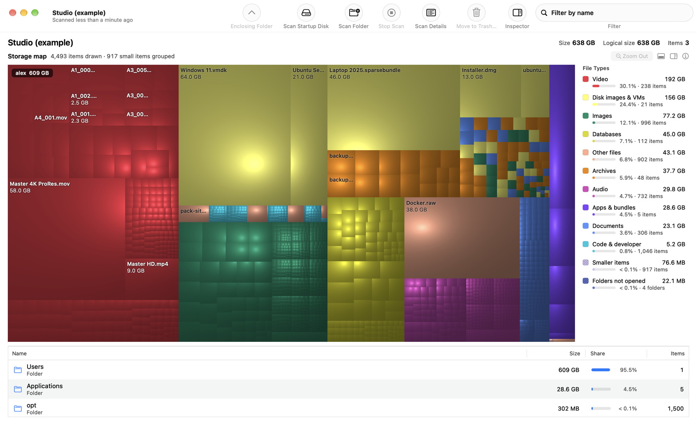

# Spacewise

Spacewise is a native macOS disk explorer inspired by [WinDirStat](https://windirstat.net). Scan your startup disk
or one folder on it to see where the space goes. In the storage map, larger tiles represent more allocated space
and colours identify file types. Zoom into a folder, sort its items by size, or reveal a file in Finder.

<picture>
  <source media="(prefers-color-scheme: dark)" srcset="docs/images/studio-wide-dark.png">
  
</picture>

*The window shows the app’s current interface with invented Studio example data.*

## Build and install

Spacewise is an **early alpha distributed as source**. There are no downloadable builds. You need:

- **macOS 15 or later**, on Apple silicon or Intel.
- **Swift 6.2 or later**, from Xcode 26 or its Command Line Tools (`xcode-select --install`). Check with
  `swift --version`.

The project is a Swift package with no third-party dependencies. Clone it and run the setup script:

```sh
git clone https://github.com/DataRelic/spacewise.git
cd spacewise
./scripts/setup.sh
```

Setup checks the Mac, builds a release app, signs it ad-hoc, installs it at `~/Applications/Spacewise.app` and
opens it. A first build takes a few minutes. Setup writes only to the checkout and `~/Applications`, and needs no
administrator password.

- **Update:** run `git pull --ff-only && ./scripts/setup.sh` from the checkout.
- **Uninstall:** quit Spacewise and move `~/Applications/Spacewise.app` to the Trash.
- **Try it without installing:** `./scripts/build.sh && ./scripts/sign.sh --adhoc && open .spacewise/Spacewise.app`.

The [local development guide](docs/LOCAL-DEVELOPMENT.md) covers running the tests, signing with a certificate,
rollback and removing development files. The [command reference](scripts/README.md) lists every script.

## Your first scan

1. Choose **Scan Folder…** and pick a small folder on your startup drive. For a whole-drive view, choose **Scan
   Startup Disk**. Both include hidden content within their scope. You can also drop a folder on the window or Dock
   icon.
2. Select a tile to inspect it, or open a folder to see its direct entries in the item list. **Filter by name**
   searches the current page during a scan and the entire open folder once the scan settles. Press Return or
   Down to move to a matching row. Wide folders filter and sort in the background, so you can keep typing or
   navigate away. The map groups smaller items. Entries without a measured size can still appear in the list.
3. Open **Scan Details** to understand gaps. It counts events and retains up to 256 location records. A folder
   Spacewise could not read has an unknown size. A partially measured folder can show a lower bound. After
   changing access, choose **Rescan**. If a replacement folder cannot be scanned, your current results stay available.
4. To try **Move to Trash…**, use a disposable personal file in your home folder. After a scan settles, the app
   shows the path and rechecks the file after confirmation. You can keep browsing during the move. Dismiss the
   success message to rescan the same scope, or use **Put Back** in Finder to restore the file. You can
   browse folders and packages and show them in Finder. Files in the system Trash still use disk space.

## Access and privacy

macOS may ask for folder access when you start a scan. You can decline and continue exploring readable locations.
Full Disk Access is optional. If you change a permission, rescan to update the results. With ad-hoc signing,
rebuilding can require granting access again.

The scanner reads names, sizes and filesystem metadata without reading file contents or requesting cloud downloads.
Results stay in memory. Spacewise saves layout preferences and writes counts, durations and error codes to the
macOS log. It has no account, analytics, update check or network client.

**Copy Path** writes to the system clipboard. **Show in Finder**, **Open** and **Quick Look** hand the selected
location to macOS or another app. Open and Quick Look recheck the selected item before handing it off. The app includes an offline policy
at **Help > Privacy Policy**. [Security and privacy](SECURITY.md)

## How to read the numbers

- **Size** is allocated space reported by the filesystem. **Logical Size** is the file’s reported length. Sparse
  files and compression can make the two differ.
- Hard-linked files contribute their bytes once. APFS clones can each report shared blocks, so adding their sizes
  can exceed the physical space in use. Neither size predicts what removing a file would free.
- The startup-disk view combines readable, verified volumes on the same physical drive. External, removable and
  network volumes are outside its scope. Symbolic links encountered during enumeration are never followed.
- macOS supplies capacity and free space separately. Snapshots, shared blocks and unread areas can all contribute
  to a difference between the map and the disk’s used space.
- Very large scans keep their index in memory. Earlier measurements on one Mac were roughly 0.4 GB per million
  entries. Folder shape and which results you are browsing affect the cost. [Scan policy](docs/SCAN-POLICY.md) ·
  [Architecture and measurements](docs/ARCHITECTURE.md)

## Options

Spacewise has no settings window. It remembers window positions and the item list's columns and sort order. The
View menu shows or hides the inspector and the item list.

The build scripts sign ad-hoc unless you choose a certificate with `--identity <SHA-1>`, the
`SPACEWISE_SIGNING_IDENTITY` environment variable or an ignored `.spacewise.local.json` file. See
[Signing](docs/LOCAL-DEVELOPMENT.md#signing).

## Known limitations

- **Startup drive only.** External, removable and network volumes cannot be scanned. A Mac that starts up from an
  external disk or a Fusion Drive is not supported.
- **Memory grows with the number of files**, at roughly 0.4 GB per million entries.
- **Move to Trash handles one file at a time**, and only a regular file in your home folder outside `Library`,
  `Applications` and packages. Folders and packages are inspection-only.
- **No Modified column, scan-wide search, Largest Files list or export.** These are on the roadmap.
- **Untested areas:** real cloud-storage placeholders, a volume disappearing during a scan, trees of tens of
  millions of entries, and VoiceOver use by a person.
- **English only.**

## Project and feedback

The [changelog](CHANGELOG.md) describes this version. Planned features are on the [roadmap](docs/ROADMAP.md).

Report bugs and suggest features in the [issue tracker](https://github.com/DataRelic/spacewise/issues). Include the
macOS version, the Spacewise version and build from **About Spacewise**, and steps using a disposable example.
Issues are public, so keep personal paths, scan results, screenshots showing your files and raw logs out of them.
Report a vulnerability privately as described in [Security](SECURITY.md#reporting-a-problem).
[Contributing](CONTRIBUTING.md)

## Licence and credits

[MIT](LICENSE). Spacewise is an independent project inspired by WinDirStat and the cushion treemaps of SequoiaView.
